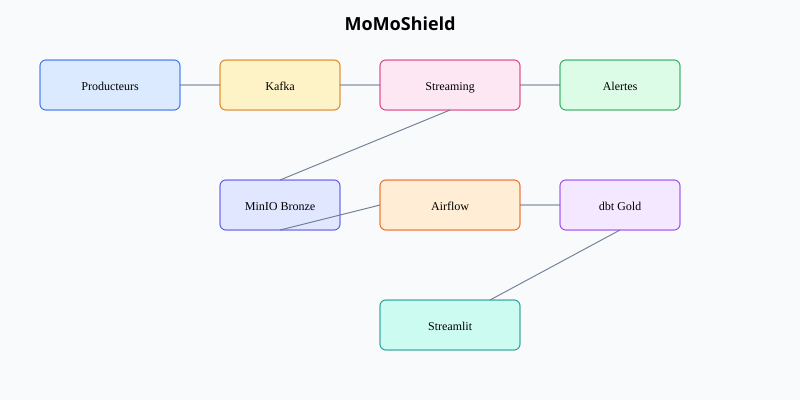

# Architecture MoMoShield

Voir aussi le diagramme Mermaid dans le [README](../README.md#architecture). Fichier source : `architecture-momoshield.svg` (schéma vectoriel portfolio).

Couches :

1. Producteurs → Kafka (`transactions.raw`)
2. Streaming → alertes + bronze MinIO
3. Airflow → silver PostgreSQL → dbt gold
4. Great Expectations → `meta.ge_validation_runs`
5. Streamlit → consommation